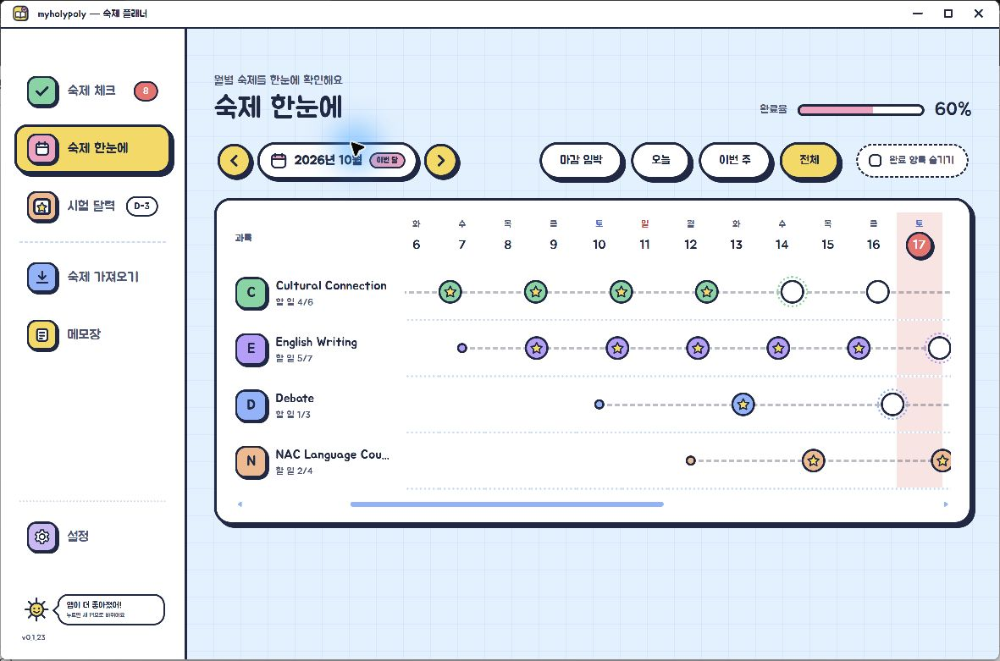

# myholypoly

POLY 웹에서 숙제를 불러와 체크하고, 과목별 진행 상황과 시험 일정을 한곳에서 관리하는 비공식 Windows 앱입니다.

> [!IMPORTANT]
> 이 프로젝트는 Korea POLY School과 제휴하거나 공식적으로 제작·보증받은 제품이 아닙니다.

## 화면 미리보기



> 화면에 표시된 과목, 숙제와 날짜는 기능 소개를 위해 만든 가상 데이터입니다.

## 주요 기능

- **숙제 체크**: 남은 숙제를 마감일 순으로 확인하고 하나씩 완료할 수 있습니다.
- **숙제 한눈에**: 과목별 시작일·마감일과 완료한 할 일을 징검다리 형태로 비교합니다.
- **시험 달력**: Monthly Test, 평가 기간, 행사처럼 숙제와 별개인 주요 일정을 월간 달력에 기록합니다.
- **숙제 가져오기**: POLY 웹에서 선택한 날짜의 숙제를 가져온 뒤 내용을 확인하고 저장합니다.
- **메모장**: 수업 준비물이나 기억할 내용을 앱 안에 따로 기록합니다.
- **앱 업데이트**: 새 버전의 변경 내용을 확인하고 앱 안에서 다운로드·검증·설치를 진행합니다.

## 설치와 업데이트

[GitHub Releases](https://github.com/magune-lab/myholypoly/releases)에서 최신 버전의 아래 두 파일을 받습니다.

- `magune-lab.cer`: 최초 설치에 필요한 공개 인증서
- `myholypoly-windows-x64-버전.appx`: 앱 설치 파일

처음 설치할 때만 인증서를 **로컬 컴퓨터 → 신뢰할 수 있는 사용자(Trusted People)** 저장소에 설치한 뒤 APPX를 실행합니다.

설치 후에는 새 버전이 있을 때 앱 왼쪽 아래의 해님 말풍선에서 변경 내용을 확인할 수 있습니다. 여러 버전을 건너뛴 경우 누적 변경 내용이 함께 표시되며, 앱 안에서 설치 파일 다운로드와 SHA-256 검증을 마친 뒤 Windows 설치 화면을 엽니다.

## 숙제 가져오기

왼쪽 메뉴의 **숙제 가져오기**에서 다음 순서로 진행합니다.

1. **POLY 웹 열어서 로그인**을 눌러 POLY 웹을 열고 직접 로그인합니다.
2. 날짜를 선택하고 숙제를 불러옵니다. 필요하면 **POLY 웹 숙제 화면 열기**에서 웹의 Homework 화면을 확인할 수 있습니다.
3. 과목 이름, 시작일, 마감일과 할 일을 확인하고 저장합니다.

웹 로그인은 POLY 사이트의 세션 정책에 따라 만료될 수 있으며, 만료되면 다시 로그인해야 합니다. 웹 화면의 1교시·2교시는 구분 정보로만 사용하고 실제 일정은 상세 화면의 과목별 숙제로 구성합니다.

myholypoly는 POLY 웹 로그인 아이디와 비밀번호를 수집하거나 별도로 저장하지 않습니다. 웹 로그인 세션은 앱의 로컬 브라우저 저장소에 남을 수 있습니다. POLY 웹 화면 구성이나 운영 정책이 변경되면 연동이 중단될 수 있습니다.

## 데이터와 개인정보

- 숙제 일정, 완료 상태, 시험 달력 일정, 메모와 앱 설정은 `%APPDATA%\myholypoly`에 저장됩니다.
- myholypoly는 사용자 데이터를 개발자 운영 서버로 전송하지 않습니다. POLY 웹 연동 시에는 로그인과 숙제 조회에 필요한 정보가 POLY 웹사이트로 전송됩니다.
- 앱을 제거해도 데이터 폴더가 남을 수 있습니다. 모든 데이터를 삭제하려면 앱을 종료한 뒤 해당 폴더를 직접 삭제하세요.
- 이전 버전에서 더 이상 사용하지 않는 설정은 앱을 실행할 때 자동으로 정리됩니다.

자세한 내용은 [PRIVACY.md](PRIVACY.md)를 확인하세요.

## 개발

```powershell
pnpm install
pnpm start
pnpm test
```

Windows APPX 생성:

```powershell
pnpm run package:msix
```

실제 사용자 데이터와 분리된 테스트 데이터로 실행하려면 `MYHOLYPOLY_DATA_PATH`에 별도 폴더를 지정할 수 있습니다.

- 지원 운영체제: Windows
- 현재 버전: `0.1.24`
- 라이선스: [MIT](LICENSE)
- 제3자 구성요소: [THIRD-PARTY-NOTICES.md](THIRD-PARTY-NOTICES.md)
- 저장소: [github.com/magune-lab/myholypoly](https://github.com/magune-lab/myholypoly)
